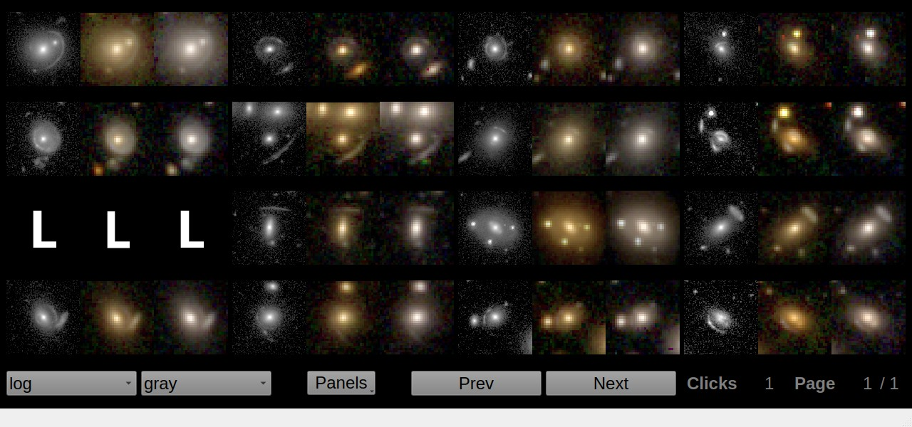
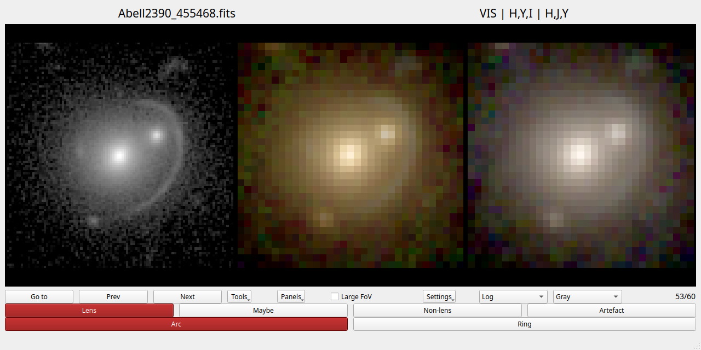
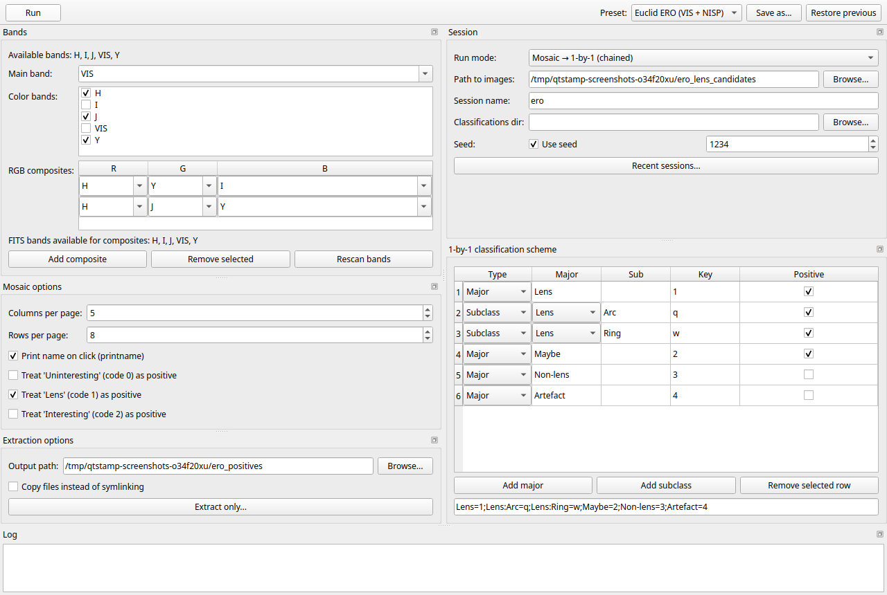

# Qt-stamp-visualizer

Qt-stamp-visualizer is a set of desktop tools for inspecting astronomical image stamps by
eye and recording what you see in them. The usual way to work is to skim hundreds of
cutouts on a grid, mark the ones worth a second look, and then go through those one at a
time with a classification scheme of your own. The tools read multiband FITS and build RGB
composites from it on the fly, handle PNG and JPG as well, and can show the same patch of
sky in Legacy Survey, PanSTARRS, ESASky or ds9 while you look. The quickest way to start
is the lobby, a launcher window that sets everything up for you. All of it is written
in Python with PySide6 (Qt) and Astropy.



<sub>All the screenshots in this README show grade A and B strong-lens candidates from the
[Euclid Early Release Observations](https://www.cosmos.esa.int/web/euclid/ero-public-release),
found by [Acevedo Barroso et al. 2025](https://arxiv.org/abs/2408.06217) in the Perseus
field and by [Nagam et al. 2025](https://arxiv.org/abs/2502.09802) in the other ERO fields.
Data from ESA/Euclid/Euclid Consortium/NASA/ERO2024.</sub>

## The three tools

| Tool | Command | What it does |
| --- | --- | --- |
| **Lobby** | `qtstamp-lobby` | The place to start. Sets up both viewers and launches either one, or both in sequence, so there are no flags to type. It can also run without a window. |
| **Mosaic** | `qtstamp-mosaic` | Shows many stamps per page on a grid, for a quick first pass; clicking a stamp marks it. |
| **1-by-1** | `qtstamp-single` | Shows one object at a time for detailed classification, with your own classes and keys. |

A typical session uses all three, and the lobby is what ties them together. You mark
candidates in the mosaic, the lobby copies or links everything you marked into a new
directory, and you then grade that smaller set in the 1-by-1 viewer. Classifications are written to CSV as you go, and each tool picks up
where you left off the next time you open it.



Nothing is tied to a particular survey. Any subdirectory of your data path counts as a
band, any three FITS bands can be combined into an RGB composite, and the 1-by-1 viewer
lets you arrange its panels in up to three rows. Each file is read as what it is, so one
dataset can mix FITS (plain, gzipped or fpacked) with PNG or JPG, and no band has
to hold every object: whatever an object has is shown, and the rest reads *no data*.
Multi-extension FITS (one file per object, with the bands stored as named extensions)
works too. The classification scheme is yours as well: major classes and subclasses,
each bound to whichever key you choose.

While you classify in the 1-by-1 viewer, Legacy Survey and PanSTARRS cutouts of the same
object can sit next to your own images, optionally downloaded ahead of time for the next
object, and ESASky, ds9 and the survey websites are a click away. Settings, presets and
download caches are kept in the directory you work from rather than in a hidden per-user
location, and a folder holding both the data and its classifications can be copied
elsewhere and resumed there.

## Install

You need Python 3.11 to 3.14. If you have [uv](https://docs.astral.sh/uv/), a single
command fetches everything and opens the lobby, without cloning anything:

```bash
uvx --from git+https://github.com/ClarkGuilty/Qt-stamp-visualizer qtstamp-lobby
```

That is all most people need. You can replace `qtstamp-lobby` with `qtstamp-mosaic` or
`qtstamp-single` to start one of the viewers directly, but the lobby will launch them for
you anyway.

If you want a copy to keep or to change, clone the repository and install it into a
virtual environment:

```bash
git clone https://github.com/ClarkGuilty/Qt-stamp-visualizer.git
cd Qt-stamp-visualizer
uv venv && uv pip install -e .            # or: python3 -m venv .venv && .venv/bin/pip install -e .
```

This adds the three `qtstamp-*` commands to the environment. Inside the checkout,
`python lobby.py`, `python mosaic.py` and `python single_viewer.py` work just as well.

<details>
<summary>With Conda instead</summary>

```bash
conda create -n qtstamp -c conda-forge "python>=3.11,<3.15" \
    numpy pandas matplotlib pyside6 pillow pyparsing astropy
conda activate qtstamp
pip install -e .        # from the checkout, for the qtstamp-* commands
```

</details>

## Quick start

The tools expect one subdirectory per band, with each object saved under the same file
name in every band:

```
my_stamps/
├── VIS/    source_001.fits  source_002.fits  ...
├── I/      source_001.fits  ...
├── Y/
├── J/
└── H/
```

Then open the lobby with `qtstamp-lobby`, point it at that directory, choose an output
directory for the stamps you will select, give the session a name, and press **Run**.
That is the whole setup. The lobby scans the directory and offers
the bands it finds, so you pick the main band, the colour bands and the RGB composites from
lists instead of typing them. The classification scheme is edited in a table, and the
shipped presets for Euclid, Legacy Survey and PanSTARRS fill in a whole setup in one
click. In the default run mode the lobby opens the mosaic first, and when you close it,
it gathers the stamps you marked into the output directory and opens them in the 1-by-1
viewer, so a full session needs no command line at all. Everything you set is remembered
for next time, and each session keeps its own classification scheme, which the
**Recent sessions** list brings back when you return to it.



### Running the viewers directly

For scripting, or once you know the flags you want, the viewers also run on their own.
Given only a path they show what is there: the layout above where the data has it (`VIS`
first, `Y`, `J` and `H` as colour bands, `H,Y,I` and `H,J,Y` as composites), otherwise
every band directory they find, or the images sitting directly in the path. To choose,
name the bands with `-b`, `-B` and `--rgb-composites`:

```bash
qtstamp-mosaic -p my_stamps -N my_name -s 1234
qtstamp-single -p my_stamps -N my_name -s 1234 -b r -B g,z --rgb-composites z,r,g
```

The lobby can also run a whole session from the command line without opening its window;
see [Headless](docs/usage.md#headless) in the usage guide.

If you have no data at hand, running `python tests/sample_data.py demo_stamps` from an
installed checkout writes a small set of fake stamps and prints the commands to open them.

### Controls

| Mosaic | | 1-by-1 | |
| --- | --- | --- | --- |
| *click* | mark as lens candidate, or clear | *1*–*5* | grade A, B, C, X, I (the default scheme) |
| *shift+click*, *ctrl+click* (macOS: *cmd+click*) | mark as interesting | *PgDn* / *j* | next object |
| *f* / *j* | next page | *PgUp* / *k* | previous object |
| *d* / *k* | previous page | *c*, *ctrl+c* | copy the file name, the coordinates |

## Documentation

The full reference lives in `docs/`. [usage.md](docs/usage.md) covers the data layouts,
the lobby with its presets and headless mode, and every flag and control of both viewers,
including the grammar of `--classifications`. [settings.md](docs/settings.md) explains
where settings, presets and caches are stored and lists every file the tools write.
[CHANGES.md](CHANGES.md) describes what this version changed and why.

## Development

```
qtstamp/          the package: the three tools plus shared modules
tests/            tests, on fake data only (tests/sample_data.py)
docs/             reference docs; make_screenshots.py regenerates docs/img/ from ERO stamps
lobby.py, mosaic.py, single_viewer.py     launchers, for running from a checkout
```

The tests run under pytest, or one file at a time without it (`python tests/test_cli.py`).
They need no display, because the Qt tests run offscreen.

## History and license

This project began as a fork of [Visualisation-tool](https://github.com/esavary/Visualisation-tool)
by esavary and was later rebuilt on Qt. The version from before this rewrite is kept on the
[`classic_tool`](https://github.com/ClarkGuilty/Qt-stamp-visualizer/tree/classic_tool)
branch, and the previous, longer README is archived in
[docs/archive/](docs/archive/README-2026-11.md).

The code is released under the MIT license (see [LICENSE](LICENSE)). The screenshots are
made from Euclid ERO data and carry ESA's credit line, which is given under the first one.
